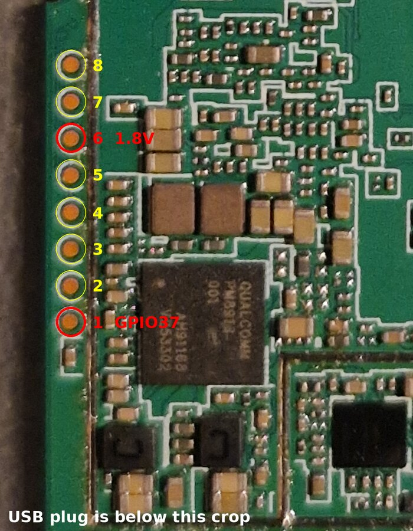

# OpenStick UF896

Alpine Linux image builder for the **UF896** MSM8916 4G USB modem stick
(board marking `UF896_V1.1`), based on
[kinsamanka/OpenStick-Builder](https://github.com/kinsamanka/OpenStick-Builder)
(`alpine` branch).

The upstream builder targets many MSM8916 dongles. This fork is tuned and
tested for the UF896. It keeps the stick's **stock partition layout**, so the
modem calibration partitions never move. It also documents the recovery
procedure and the pitfalls that can brick this particular board.

> [!WARNING]
> Flashing bootloaders and firmware can make the device unbootable. Read the
> whole document first, make a full backup, and proceed at your own risk.

## What is different from upstream

| Area | Upstream | This repo |
| --- | --- | --- |
| Partition table | generic `gpt_both0.bin`, moves partitions | [`scripts/uf896_gpt.py`](scripts/uf896_gpt.py) derives it from the stick's own stock GPT, so calibration partitions stay put |
| `tz` partition | 1 MiB in the generic GPT | stock UF896 `tz` is 512 KiB, too small for the 64-bit `tz.mbn` (~591 KiB); the tool grows it to 1 MiB |
| lk2nd (`aboot`) | generic build | built with the UF896 DTB (`thwc,uf896`), so the reset button works; the build refuses images without it |
| lk2nd GPT write | erases the whole eMMC | [patched](patches/lk2nd) to keep eMMC contents and partition boundaries |
| rootfs permissions | setuid bits lost (`sudo`, `passwd` broken) | restored from the apk database at build time |
| `/etc/fstab` `/boot` | `/dev/mmcblk0p14` (`modemst2` on UF896!) | the `boot` PARTUUID |
| LEDs | unused | red = heartbeat, green = USB traffic, blue = Wi-Fi traffic |
| Logging / time | chrony | busybox `syslogd`/`klogd` and `ntpd` |
| `nmcli` wrapper | breaks arguments with spaces | fixed quoting |

## Hardware notes

- SoC: Qualcomm MSM8916; eMCP: SK Hynix H9TP32A4GDMC (3.6 GiB eMMC)
- Stock firmware: Android 4.4.4 with a **32-bit TrustZone** (`TZ.BF.2.5.3`).
  It cannot start a 64-bit kernel: lk2nd hands over to the kernel and the
  stick hangs silently until the watchdog resets it. The 64-bit firmware set
  (`sbl1`, `tz`, `rpm`, plus `qhypstub` as `hyp`) **must** be installed.
- Reset button: GPIO35. Hold it while plugging in to enter fastboot (needs an
  `aboot` built with the UF896 DTB, as this repo does).
- LEDs: `red:power` (GPIO82), `green:wlan` (GPIO83), `blue:wan` (GPIO81).

### Test pads and EDL

The `UF896_V1.1` board has a row of **8 round test pads** along the long edge
of the SIM-slot side. Hold the board with the USB plug on the left and the
pads on top, then count from the USB end:

| Pad | Signal |
| --- | --- |
| 1 | GPIO37: pull up to 1.8 V at power-on to force EDL |
| 2 | GPIO35 (reset button) |
| 3 | UART RX |
| 5 | GPIO0 |
| 6 | 1.8 V |
| 8 | UART TX |

**Forcing EDL (Qualcomm 9008 mode)** is handled by the SoC boot ROM before the
eMMC is read, so it works even when the bootloader is broken:

1. Optionally confirm with a multimeter: pad 6 should read about 1.8 V and
   pad 1 about 0 V to ground.
2. Bridge **pad 1 and pad 6** with tweezers, plug the stick in, hold the
   bridge for about 5 seconds, then release.
3. `lsusb` shows `05c6:9008 Qualcomm ... (QDL mode)`.



Photos of both sides of the board and the full step-by-step recovery of a
bricked stick are in [docs/RECOVERY.md](docs/RECOVERY.md).

Pad map and EDL method: Cole Mickens and Informatic (see [Credits](#credits)).

Other ways in:
- from fastboot: `fastboot oem reboot-edl`
- from stock Android: `adb reboot edl`

## Build

Tested on Debian/Ubuntu. Run as root:

```shell
git clone --recurse-submodules https://github.com/cstroie/OpenStick-UF896.git
cd OpenStick-UF896
sudo ./build.sh
```

Or step by step:

```shell
sudo scripts/install_deps.sh
sudo scripts/build_hyp_aboot.sh   # qhypstub + lk2nd (UF896 DTB, patched, test-signed)
sudo scripts/extract_fw.sh        # 64-bit sbl1/tz/rpm from the DragonBoard 410c release
sudo scripts/alpine_rootfs.sh     # Alpine rootfs
sudo scripts/build_images.sh      # boot.raw / rootfs.raw and sparse images in files/
```

`LK2ND_FORCE_FASTBOOT=1 scripts/build_hyp_aboot.sh` builds an `aboot` that
always stops in fastboot, which is useful for a first install.
`BOOT_DEV=...` overrides the `/boot` device written to `fstab`.

## Install

Prebuilt images are on the
[releases page](https://github.com/cstroie/OpenStick-UF896/releases): the
release notes list each file and its partition. To build your own, see
[Build](#build).

Everything below goes through EDL, so each write can be read back and
compared. Use the [edl](https://github.com/bkerler/edl) tool with an MSM8916
firehose programmer (`prog_emmc_firehose_8916.mbn`). Below, `L` stands for
`--loader=prog_emmc_firehose_8916.mbn --memory=emmc`.

### 1. Back up the stock firmware

```shell
edl rf full_emmc.bin $L        # full eMMC dump - keep it safe
for n in fsc fsg modem modemst1 modemst2 persist sec; do edl r $n $n.bin $L; done
```

`modemst1`, `modemst2`, `fsg` and `persist` hold the stick's own modem
calibration and identity. Nothing below writes to them, but keep the copies
anyway.

### 2. Create the partition table

```shell
dd if=full_emmc.bin of=stock_gpt.bin bs=512 count=34
scripts/uf896_gpt.py stock_gpt.bin files/gpt-uf896.bin
```

The script refuses input that does not look like a stock UF896 table, and it
prints where the backup copy goes (`LBA 7569375` on a 3.6 GiB eMMC).

### 3. Flash

```shell
dd if=files/gpt-uf896.bin of=gpt-primary.bin bs=512 count=34
dd if=files/gpt-uf896.bin of=gpt-backup.bin  bs=512 skip=34 count=33
edl ws 0       gpt-primary.bin $L
edl ws 7569375 gpt-backup.bin  $L     # use the LBA printed by uf896_gpt.py

for p in sbl1 rpm tz hyp aboot; do edl w $p files/$p.mbn $L; done
edl w boot   boot.raw   $L
edl w rootfs rootfs.raw $L
edl reset $L
```

After writing, check each partition: `edl r <part> readback.bin $L` and
compare it with the file you wrote. The stick then boots Alpine. The USB
network comes up after about 10 seconds.

> [!CAUTION]
> Do not use `fastboot flash partition` with an lk2nd that lacks this repo's
> patch: upstream lk2nd **erases the entire eMMC** before writing a GPT.
> Flashing `boot`/`rootfs` (sparse images in `files/`) with `fastboot flash`
> is fine.

## After installation

| Interface | Address |
| --- | --- |
| `usb0` (CDC-NCM) | stick `192.168.5.1`, DHCP for the host |
| `wlan0` hotspot | SSID `Openstick`, password `openstick`, `192.168.4.1` |

- Login over SSH: user `user`, password `1`. Change it right away (`passwd`),
  and set a root password (`sudo passwd root`). The root password starts
  empty.
- Join a Wi-Fi network as a client; it takes priority over the hotspot:
  ```shell
  sudo nmcli con add type wifi ifname wlan0 con-name home ssid MySSID \
      wifi-sec.key-mgmt wpa-psk wifi-sec.psk "my password" \
      connection.autoconnect-priority 20
  sudo nmcli con modify hotspot connection.autoconnect-priority -10
  ```
- On the host, stop the stick from becoming your default route:
  `nmcli con modify <stick-connection> ipv4.never-default yes ipv6.never-default yes`
- Time comes from busybox `ntpd` once a network is up (the stick has no RTC
  battery). Logs are in `/var/log/messages`.

## Pitfalls we hit (and how to avoid them)

1. **`aboot` built without `LK2ND_BUNDLE_DTB`/`LK2ND_COMPATIBLE`.** Without
   the board DTB the reset button is not wired up. If the boot then hangs,
   the stick never enumerates again, and only the test pads bring it back.
   `build_hyp_aboot.sh` now refuses such images.
2. **Skipping `sbl1`/`tz`/`rpm`/`hyp`.** The stock 32-bit TZ cannot boot a
   64-bit kernel. Flash all four together, never a mix of stock and new.
3. **`tz.mbn` does not fit the stock `tz` partition** (`fastboot: size too
   large`). Use the GPT from `uf896_gpt.py`. If a flash fails halfway, put the
   stock images back *before* rebooting.
4. **Unsigned `aboot`.** The images in `files/` are signed with `qtestsign`;
   the raw `emmc_appsboot.mbn` from the lk2nd build is not.
5. **Kernel package updates.** `/boot` is not mounted by default. Mount it
   (`mount /boot`, or enable `localmount`) before `apk upgrade` installs a
   new `linux-postmarketos-qcom-msm8916`. Otherwise the new kernel lands in
   the rootfs while the modules of the running kernel are replaced.

## UZ801 v3 with Arch Linux ARM

The UZ801 v3 (stock Android 4.4, `ro.product.model=UZ801`, baseband
`N958St_Z85`) uses the same MSM8916 and the **same stock GPT** as the UF896,
so the tools above apply. Differences:

| | UF896 | UZ801 v3 |
| --- | --- | --- |
| lk2nd board | `thwc,uf896` (`msm8916-512mb-qrd-skuh.dtb`) | `yiming,uz801-v3` (`msm8916-512mb-mtp.dtb`) |
| Kernel DTB | `msm8916-thwc-uf896` | `msm8916-yiming-uz801v3` |
| Reset button | GPIO35 | GPIO23 |
| Backup GPT LBA (3.6 GiB eMMC) | 7569375 | 7634911 |

Getting in: the stock web UI's `http://192.168.100.1/usbdebug.html` enables
ADB (`POST /ajax {"funcNo":2001}`), which gives a root shell, and
`adb reboot edl` then enters EDL with no test pads needed.

Build (no root needed: with `uidmap` installed the rootfs script runs in a
user namespace):

```shell
BOARD=uz801 scripts/build_hyp_aboot.sh       # files/uz801/{aboot,hyp}.mbn
scripts/uf896_gpt.py --rootfs-size max stock_gpt.bin files/uz801/gpt.bin
scripts/arch_rootfs.sh                       # files/uz801/{boot,rootfs}.img
```

`arch_rootfs.sh` uses the Arch Linux ARM aarch64 userland with the
postmarketOS MSM8916 kernel. It loads modem and Wi-Fi firmware from the
stick's own partitions (pmOS `msm-firmware-loader`) and builds `rmtfs` and
`libqrtr` from source. The image is sized to its contents and grows to the
whole 2.6 GiB partition on first boot (`x-systemd.growfs`). Re-runs can
reuse the chroot with `RESUME=1`.

Flash as in [Install](#install), with `files/uz801/hyp.mbn`,
`files/uz801/aboot.mbn`, `boot.img` and `rootfs.img`, and the backup GPT at
LBA 7634911. The network, login and hotspot settings match the Alpine image.
Time comes from `systemd-timesyncd`, and the journal is kept in RAM only
(`journalctl`).

## Credits

This repository builds on the work of many people:

- **GP Orcullo ([kinsamanka](https://github.com/kinsamanka))**:
  [OpenStick-Builder](https://github.com/kinsamanka/OpenStick-Builder), the
  build system this repo is forked from (MIT).
- **[msm8916-mainline](https://github.com/msm8916-mainline)** (Stephan
  Gerhold and contributors):
  [lk2nd](https://github.com/msm8916-mainline/lk2nd),
  [qhypstub](https://github.com/msm8916-mainline/qhypstub) and
  [qtestsign](https://github.com/msm8916-mainline/qtestsign), plus the
  mainline Linux support for MSM8916 including the `msm8916-thwc-uf896`
  device tree.
- **[postmarketOS](https://postmarketos.org/)**: the
  `linux-postmarketos-qcom-msm8916` kernel and MSM8916 packages.
- **[Alpine Linux](https://alpinelinux.org/)**: the root filesystem.
- **Bjoern Kerler ([bkerler](https://github.com/bkerler))**:
  [edl](https://github.com/bkerler/edl), the Qualcomm EDL/firehose client
  used for backup and recovery.
- **Cole Mickens ([colemickens](https://github.com/colemickens)) and
  Informatic (hackerspace.pl)**: the UF896 test-pad map and the pad 1 + pad 6
  EDL recovery method, documented in Cole's
  [mobile-nixos OpenStick notes](https://github.com/colemickens/mobile-nixos/tree/colemickens/openstick-aug2024/devices/openstick).
- The contributors to the OpenWrt forum thread
  [UF896 - Qualcomm MSM8916 LTE router](https://forum.openwrt.org/t/uf896-qualcomm-msm8916-lte-router-384mib-ram-2-4gib-flash-android-openwrt/131712),
  and the original **OpenStick** project by HandsomeHacker.
- UF896 port, recovery and fixes: **Costin Stroie**, with help from Claude
  (Anthropic).

## License

MIT, see [LICENSE](LICENSE). The submodules (lk2nd, qhypstub, qtestsign)
and the downloaded Qualcomm firmware are under their own licenses.
