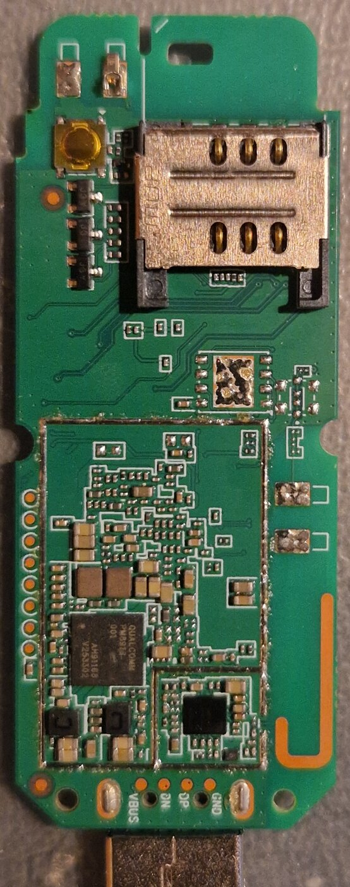
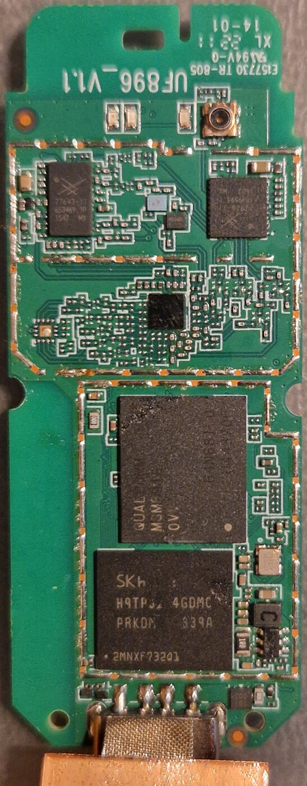
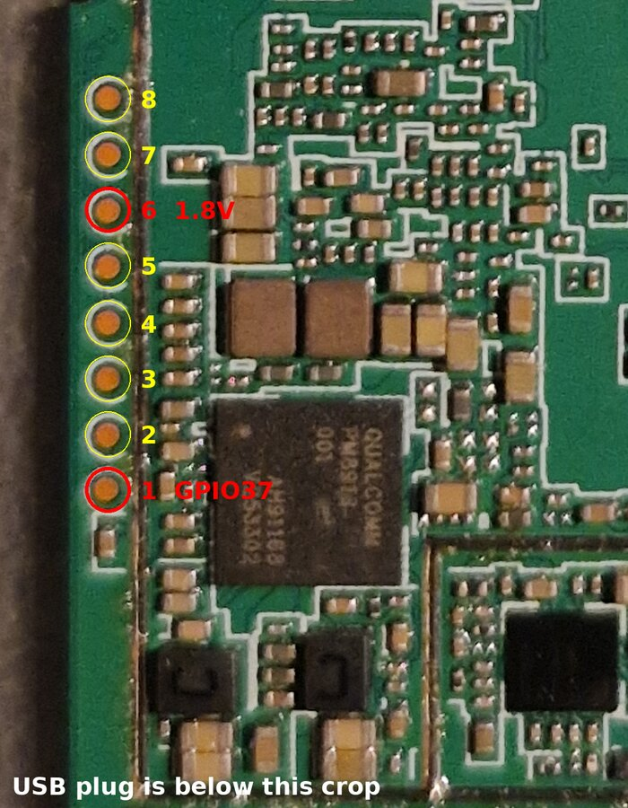
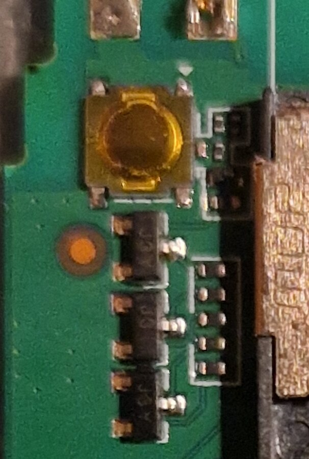
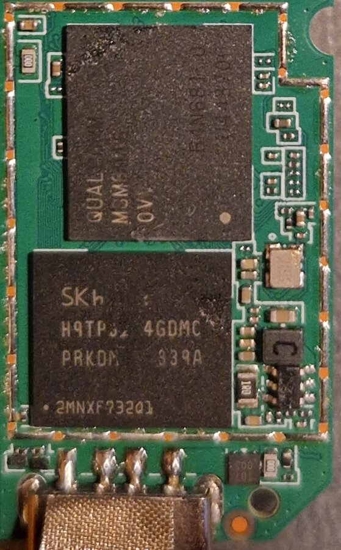

# Recovering a bricked UF896

This is the procedure that brought a real `UF896_V1.1` stick back. It had
been flashed with a broken `aboot` and no longer showed up on USB at all.
It works whatever state the eMMC is in, because EDL mode is entered by the
SoC boot ROM before anything is read from the eMMC.

> [!IMPORTANT]
> Work one step at a time and read back everything you write. Never erase or
> overwrite `modemst1`, `modemst2`, `fsg`, `persist` or `sec`: they hold
> this stick's own modem calibration and identity, and no other stick's copy
> will do. Keep the full backup somewhere off the PC you are working on.

## Symptoms

| What you see | Likely state |
| --- | --- |
| Nothing in `lsusb`, LEDs dark or stuck | broken `aboot`, or a hang before USB starts |
| `18d1:d00d` (fastboot) | lk2nd is running; you can flash from there |
| Stick enumerates, then drops after about 25 s and repeats | the kernel starts under the stock 32-bit TZ and the watchdog resets the stick; flash the 64-bit firmware (see below) |
| `05c6:9008` (QDL mode) | EDL; continue at [step 2](#2-connect-with-edl) |

If the reset button still works (an `aboot` built with the UF896 DTB),
holding it while plugging in gives fastboot, and `fastboot oem reboot-edl`
gives EDL. Otherwise, use the test pads.

## What you need

- [edl](https://github.com/bkerler/edl), installed from its git repository
- an MSM8916 eMMC firehose programmer, `prog_emmc_firehose_8916.mbn`
- fine tweezers or a short piece of wire
- optional: a multimeter
- optional, for the board: a plastic opening tool. The case clips apart;
  the test pads are on the side with the SIM slot.

Below, `L` stands for
`--loader=prog_emmc_firehose_8916.mbn --memory=emmc`.

## 1. Force EDL with the test pads

| SIM-slot side (test pads on the left edge) | SoC / eMCP side |
| --- | --- |
|  |  |



The 8 round pads run along the long edge of the SIM-slot side. **Pad 1 is
the one nearest the USB plug** (at the bottom of the photo above, next to the
PM8916 PMIC).

| Pad | Signal |
| --- | --- |
| 1 | GPIO37: pulled to 1.8 V at power-on, it forces EDL |
| 2 | GPIO35 (reset button) |
| 3 | UART RX |
| 5 | GPIO0 |
| 6 | 1.8 V |
| 8 | UART TX |

1. Optional check: plug the stick in and measure to ground (the USB shield
   is ground). Pad 6 should read about **1.8 V** (1.79 V here) and pad 1
   about **0 V**. Unplug.
2. Bridge **pad 1 and pad 6** with the tweezers.
3. Plug the stick in while you hold the bridge. Keep holding it for about
   5 seconds, then release.
4. Check:
   ```shell
   lsusb | grep 05c6:9008    # Qualcomm ... QDL mode
   ```
   If it isn't there, unplug and try again. Good contact on both pads is
   usually the problem.

For reference, the reset button on the other side of the board:



The SoC and eMCP side, to identify the board (MSM8916 and SK Hynix
H9TP32A4GDMC):



## 2. Connect with EDL

```shell
edl printgpt $L
```

This loads the firehose programmer and prints the partition table. If it
fails right after loading, unplug, re-enter EDL and try again. The firehose
only accepts one session per power-up.

## 3. Back up before anything else

```shell
edl rf full_emmc.bin $L
sha256sum full_emmc.bin > full_emmc.bin.sha256
for n in fsc fsg modem modemst1 modemst2 persist sec; do edl r $n $n.bin $L; done
```

Also keep a copy of each partition you are about to replace (`aboot`, `sbl1`,
`rpm`, `tz`, `hyp`). If a stick is already bricked, the broken `aboot` is
worth keeping too, for diagnosis. Then make everything read-only:
`chmod a-w *.bin`.

## 4. Restore a working `aboot`

The quickest way back is an `aboot` that **always stops in fastboot** and is
built with the UF896 DTB:

```shell
LK2ND_FORCE_FASTBOOT=1 sudo scripts/build_hyp_aboot.sh
edl w aboot files/aboot.mbn $L
edl r aboot aboot-readback.bin $L
cmp -n $(stat -c %s files/aboot.mbn) files/aboot.mbn aboot-readback.bin && echo OK
edl reset $L
```

`lsusb` should now show `18d1:d00d`, and `fastboot devices` lists the stick.

If you only have the stock firmware backup, you can instead write the stock
`aboot` back. The stick then boots Android again.

## 5. Install the 64-bit firmware

The stock 32-bit TrustZone (`TZ.BF.2.5.3`) cannot start a 64-bit kernel:
the boot hangs at the hand-over and the watchdog resets the stick after
about 25 seconds. `sbl1`, `tz`, `rpm` and `hyp` have to be replaced as one
set.

The 64-bit `tz.mbn` (~591 KiB) does not fit the stock 512 KiB `tz`
partition, so the partition table changes first. This was done through EDL,
not fastboot:

```shell
edl rs 0 34 stock_gpt.bin $L
scripts/uf896_gpt.py stock_gpt.bin gpt-uf896.bin   # prints the backup LBA
dd if=gpt-uf896.bin of=gpt-primary.bin bs=512 count=34
dd if=gpt-uf896.bin of=gpt-backup.bin  bs=512 skip=34 count=33
edl ws 0       gpt-primary.bin $L
edl ws 7569375 gpt-backup.bin  $L   # the LBA printed above
edl printgpt $L                      # check tz is now 1 MiB
```

Only the GPT sectors change. The other partitions keep their stock offsets,
so the calibration data does not move.

Then write the firmware, reading back each partition:

```shell
for p in sbl1 rpm tz hyp; do
    edl w $p files/$p.mbn $L
    edl r $p rb_$p.bin $L
    cmp -n $(stat -c %s files/$p.mbn) files/$p.mbn rb_$p.bin && echo "$p OK"
done
edl reset $L
```

The stick should come up in fastboot again (with the forced-fastboot
`aboot`). `fastboot continue` boots the installed system.

## 6. Switch to the auto-booting `aboot`

Once the stick boots, build the normal `aboot` and write it the same way:

```shell
sudo scripts/build_hyp_aboot.sh          # LK2ND_FORCE_FASTBOOT=0
fastboot oem reboot-edl
edl w aboot files/aboot.mbn $L
edl r aboot aboot-readback.bin $L
cmp -n $(stat -c %s files/aboot.mbn) files/aboot.mbn aboot-readback.bin && echo OK
edl reset $L
```

The stick now boots Alpine in about 8 seconds. Holding the reset button while
plugging in still gives fastboot.

## 7. Fix a rootfs offline (optional)

If the system boots but is broken (for example `sudo` without its setuid
bit), the rootfs can be repaired from the PC without a working login:

```shell
edl r rootfs rootfs.img $L
cp rootfs.img rootfs-before-fix.img
e2fsck -fy rootfs.img                     # replays the journal
debugfs -w rootfs.img -R 'sif /usr/bin/sudo mode 0104755'
edl w rootfs rootfs.img $L
```

## What went wrong here, in order

1. An lk2nd `aboot` built **without** `LK2ND_BUNDLE_DTB`/`LK2ND_COMPATIBLE`
   was flashed. Without a board definition the reset button did nothing.
   Then the stock 32-bit TZ hung the kernel start, and the stick never
   reached USB.
2. Pads 1 + 6 → EDL. Backup, then an `aboot` that always stops in fastboot.
3. Flashing the 64-bit firmware from fastboot failed at `tz` (`size too
   large`). The stock `sbl1`/`rpm`/`hyp` were restored **before**
   rebooting.
4. The GPT was regenerated with `uf896_gpt.py` and written via EDL, and the
   four firmware images were written and read back via EDL.
5. Alpine booted. The auto-booting `aboot` was installed, and the setuid bits
   were fixed offline.

`build_hyp_aboot.sh` now refuses an `aboot` without the UF896 DTB, and
`alpine_rootfs.sh` restores the file modes, so neither failure should happen
with this repo.

## Credits

The test-pad map and the pad 1 + pad 6 EDL method come from Cole Mickens and
Informatic ([mobile-nixos OpenStick notes](https://github.com/colemickens/mobile-nixos/tree/colemickens/openstick-aug2024/devices/openstick)).
The photos are of the author's own board.
